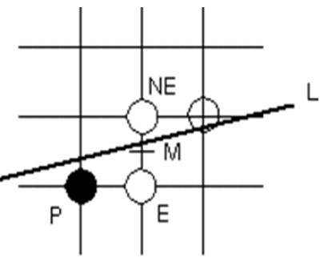
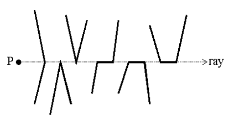
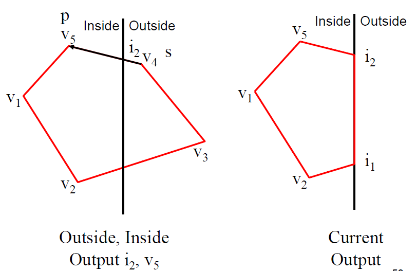

# 2 Raster

<!-- !!! tip "说明"

    本文档正在更新中…… -->

!!! info "说明"

    本文档仅涉及部分内容，仅可用于复习重点知识

## 1 2D Graphics Algorithms

用几何图元（点、线、多边形）数字化地建模世界之后，渲染要回答两个问题：图元覆盖了哪些像素？每个像素该是什么颜色？==把图元转换成像素集合的过程就叫光栅化（rasterization / scan conversion）==

- 直线段是描述"边缘"的工具，而 ==人类对形状的感知主要由边缘主导==，所以画线是最基础、也最值得优化的算法
- **光栅图形软件包（raster graphics package）** 就是一组高效的扫描转换算法；高性能工作站把这些算法直接做进硬件
- 学习这些算法的意义在于，它们常常是 ==用极少的硬件换来巨大性能提升== 的算法优化范例（用增量代替重复计算、用整数代替浮点）

### 1.1 Point Classification

**点分类（point classification）：** 给定点 $P$ 与几何实体 $E$，判断 $P$ 位于 $E$ 的外部、内部还是边界上。这是图形学中最基础的操作之一

以直线 $ax + by + c = 0$ 为例，令 $v = ax_0 + by_0 + c$：

- $v < 0$：$P$ 在直线内侧
- $v = 0$：$P$ 在直线上
- $v > 0$：$P$ 在直线外侧

==只需算一个函数值再判符号==，比求交便宜得多；第 1 章里的叉乘判据就是它的特例

### 1.2 Rasterization 的两个步骤

1. **扫描转换（rasterization / scan conversion）：** 确定图元覆盖了哪些像素
2. **着色：** 确定这些像素各自应被赋予的颜色

==这两步的效率直接决定了显示系统的性能==，也是本章所有算法的出发点

## 2 Scan Converting a Line Segment

给定线段的两个端点，找出最能代表这条线段的像素与颜色

### 2.1 画线算法的要求

- 选出的像素应尽量贴近理想直线
- 像素序列应尽量"直"；同一条线的亮度不应随长度和方向变化
- 起点与终点要准确
- 越快越好
- 支持不同的线宽与线型（虚线等）

### 2.2 直线方程与 DDA

直线方程 $y = mx + c$，其中斜率

$$
m = \dfrac{y_2 - y_1}{x_2 - x_1} = \dfrac{\Delta y}{\Delta x}
$$

先只讨论 **第一八分圆（first octant）** 的情形（$0 \le m \le 1$），其余情况都可以由对称性推出

**DDA（Digital Differential Analyzer，数值微分分析器）：** 利用直线的微分关系

$$
y_i = m \cdot x_i + c
$$

每步把 $x$ 增加 1，$y$ 就相应增加 $m$：

$$
x_i = x_{i-1} + 1, \qquad y_i = y_{i-1} + m
$$

然后点亮像素 $[x_i,\ \text{round}(y_i)]$

- 它是 **增量算法（incremental algorithm）**：每一步只在上一步的结果上做一次加法
- 缺点：==需要浮点运算和取整==，在早期硬件上代价很高；中点画线算法正是为了消掉浮点而提出的

### 2.3 Midpoint Line Algorithm

<figure markdown="span">
  { width="300" }
</figure>

思路：每一步在 **East（E）** 与 **NorthEast（NE）** 两个候选像素中二选一，判据是 ==两条候选连线的中点 $M$ 落在直线的哪一侧==

为此不再用 $y = mx + c$，而用直线的隐式方程

$$
F(x, y) = ax + by + c = 0
$$

对端点 $(x_1, y_1)$ 与 $(x_2, y_2)$ 取

$$
a = dy = y_2 - y_1, \qquad b = -dx = -(x_2 - x_1), \qquad a + b = dy - dx
$$

因为 $b < 0$，固定 $x$ 时 $y$ 越大 $F$ 越小，于是中点 $M = \left(x_p + 1,\ y_p + \dfrac{1}{2}\right)$ 的符号就给出了选择：

- $F(M) < 0$：$M$ 在直线 **上方** → 直线更靠近下方的 $E$ → ==选 E==
- $F(M) > 0$：$M$ 在直线 **下方** → 直线更靠近上方的 $NE$ → ==选 NE==

**决策变量** 取 $d = F(M) = a(x_p + 1) + b\left(y_p + \dfrac{1}{2}\right) + c$。为了消掉 $1/2$，实现时把整个式子乘 2（==乘以正数不改变符号==）：

- **初值：** 第一个中点 $M_1 = \left(x_1 + 1,\ y_1 + \dfrac{1}{2}\right)$，又因端点 $(x_1, y_1)$ 在直线上故 $F(x_1, y_1) = 0$，所以 $2d_1 = 2a + b = 2dy - dx$
- **增量：** 若选 E，中点只向右移 1，$F$ 增加 $a$，即 $2d$ 增加 $2a = 2dy$；若选 NE，中点向右上方移动 1，$F$ 增加 $a + b$，即 $2d$ 增加 $2a + 2b = 2(dy - dx)$

```c linenums="1"
// 只讨论第一八分圆：0 <= dy <= dx
dx = x2 - x1;  dy = y2 - y1;
incrE  = 2 * dy;                 // 选 E 时决策变量的增量
incrNE = 2 * (dy - dx);          // 选 NE 时决策变量的增量
d = 2 * dy - dx;                 // 初始决策变量，即 2 * F(M1)
y = y1;
for (x = x1; x <= x2; x++) {
    SetLineColour(x, y);
    if (d > 0) { y++; d += incrNE; }     // 中点在直线下方 → 选 NE
    else       {      d += incrE;  }     // 中点在直线上方 → 选 E
}
```

**优点：**

- 增量计算，每一步只做几次整数加法
- ==全程整数运算==，不需要浮点，也不需要取整
- 对理想直线给出最佳逼近（best fit）

!!! tip "关于符号约定"

    不同教材把直线方程写成 $ax + by + c = 0$ 还是 $F(x, y) = dy \cdot x - dx \cdot y + c$，$a$、$b$ 的正负号约定不同，于是"$d > 0$ 时选 E 还是选 NE"会互相颠倒。==不要背结论，记住几何判据==：中点落在直线上方就选下面那个像素（E），落在下方就选上面那个（NE）

    另外 $d = 0$（中点恰好在直线上）时两个像素等距，任选一个即可，上面的代码约定选 E

**与 Bresenham 算法的关系：** Bresenham 的原始形式直接比较两个候选像素到理想直线的距离 $d_1$ 与 $d_2$（谁近选谁），==这与"比较中点落在直线的哪一侧"是等价的==，所以中点画线算法也常被直接称作 Bresenham 算法

Bresenham 算法还有两个推广：

- **网格路径查找（path finding）：** 在离散网格上求连接两点的路径
- **3D Bresenham：** 在三维体素网格上离散化线段，用于体绘制、光线步进等

### 2.4 其他问题

- **其他八分圆：** $|m| > 1$ 时把 $x$、$y$ 的角色互换（改以 $y$ 为自变量），再按象限处理符号
- **端点顺序无关：** $P_0 \to P_1$ 与 $P_1 \to P_0$ 应画出完全相同的像素
- **先裁剪再画：** 线段被裁剪后起点不再落在像素中心，$d_0$ 要按新的起点重新计算
- **亮度随斜率变化：** 不抗锯齿时无法避免（见第 4 节）
- **相连的线段：** 公共端点可能被重复绘制，在某些混合或透明模式下会带来问题

## 3 Polygon Filling

### 3.1 Inside Test

最简单的填充方式是对光栅中的每一个像素做内/外测试，判据用 **even-odd（奇偶）规则** 或 **winding number（环绕数）规则**（细节见 [ch1.md](./ch1.md){:target="_blank"} 的第 4 节）。为了少算一些像素，可以先用 **包围盒（bounding box）** 把测试范围缩小到多边形的最小外接矩形

### 3.2 Scan Line Method

按扫描线一行一行地填充，==用扫描线与多边形边界的交点来确定哪些像素在内部==：从左到右扫描，把交点成对配起来，成对交点之间的像素全部填充

#### 3.2.1 Coherence

- **空间相干性（spatial coherence）：** 除边界附近外，相邻像素往往具有相同的特性
- **跨度相干性（span coherence）：** 同一条扫描线上，实心填充的连续像素取相同的值
- **扫描线相干性（scan line coherence）：** 相邻扫描线上的像素往往具有相同的特性

相干性是各种增量算法的共同思想基础：==能从上一步的结果推出下一步，就不要重新计算==

#### 3.2.2 算法与特殊情况

**算法：**

1. 求当前扫描线与多边形所有边的交点
2. 把交点按 $x$ 坐标递增排序
3. 成对取交点（第 1、2 个之间，第 3、4 个之间……），把每对之间的像素填上指定强度

<figure markdown="span">
  { width="400" }
</figure>

**特殊情况：顶点与水平边。** 扫描线正好穿过顶点时，顶点处的两条边都与扫描线相交，==如果都计数就会重复统计，把内外关系弄反==，所以要结合整体拓扑来判断：

- 两条边分别位于扫描线两侧（一次真正的穿越）→ 该顶点算 **1** 个交点
- 两条边都在扫描线同一侧（顶点是局部极值，扫描线正好切过尖端）→ 算 **2** 个交点，这样配对后两个交点之间为空，等价于不填充
- 与扫描线共线的 **水平边** → 直接忽略

!!! tip "更省事的实现：半开区间"

    与其逐类讨论，不如给每条边规定半开区间：只有满足 $y_{\min} \le y < y_{\max}$ 的扫描线才把这条边计入。这样每个顶点只会被它的两条边中的一条"负责"：局部极小顶点被算 2 次，局部极大顶点被算 0 次，正常穿越顶点被算 1 次，==奇偶性永远是对的==，水平边也自动被排除

    这正是 [ch1.md](./ch1.md){:target="_blank"} 中射线法所写的判定条件：两个端点的 $y$ 恰好只有一个严格大于扫描线

#### 3.2.3 效率优化

- **边相干性（edge coherence）：** 扫描线向下移动一行时，同一条边与扫描线的交点 $x$ 只增加 $1/m$

$$
x_{i+1} = x_i + \dfrac{1}{m}
$$

==于是不必对每条扫描线重新求交，只做一次加法==

- **活性边表（active edge list，AEL）：** 只维护当前真正与扫描线相交的那些边，每行增量更新
- 多边形越规整越快：凸多边形比凹多边形快，而 ==全是三角形时最快==，这也是图形硬件最终只处理三角形的原因之一

#### 3.2.4 优点

- 效率高，==每个像素只被访问一次==
- 容易与着色算法结合：填充的同时插值颜色（例如沿扫描线对两端的颜色插值），直接得到着色区域

### 3.3 Seed Fill

**种子填充（seed fill）：** 假设已知多边形内部至少一个像素（种子），从它出发递归地把相邻的内部像素填满

- 递归算法，实现简单
- 常用于交互式画图软件的"油漆桶"工具
- 连通性：**4-连通（4-connected）** 只走上下左右四个方向，**8-连通（8-connected）** 还包括四个对角方向
- ==连通性的选择会影响结果==：若边界本身是 8-连通的，用 4-连通填充不会漏出去，反之可能漏到区域外
- 与扫描线法的思路相反：扫描线法是"按行推进 + 内外判据"，种子填充是"从内部向外扩散"，只需判断"是否已填充 / 是否是边界色"

## 4 Aliasing and Antialiasing

### 4.1 Aliasing

- 混叠（aliasing）源于显示设备的离散性
- 光栅化本质上是对连续信号的 **采样（sampling）**：用有限个采样值（点采样，point sampling）表示连续信号
- ==采样率不足就会丢失信息==，这种采样误差就叫混叠
- 典型表现：
    - 边缘呈锯齿状（jaggies）
    - 细节被错误渲染
    - 小物体可能整个漏掉（表现为闪烁、抖动）

### 4.2 Antialiasing

抗锯齿（antialiasing）就是用各种技术削弱或消除混叠。常见方法：

- **提高分辨率：** 直接提高采样率；代价是 ==分辨率翻倍，显存需求变为四倍==
- **平均法（后处理）：** 像素强度取自身强度与周围像素强度的加权平均；简单，但会让整幅图像变糊
- **区域采样（area sampling）：** 更常用，见下

### 4.3 Area Sampling

- 扫描转换后的图元在屏幕上占据有限面积
- 边界像素的强度按 ==该像素被图元覆盖的面积比例== 来调整，称为 **加权区域采样（weighted area sampling）**
- 权重还可以取决于覆盖区域 **到像素中心的距离**（越靠近中心贡献越大）

估计覆盖比例的办法：

- 把像素细分成子像素，数一数有多少个子像素落在边界内（子像素越多越准）
- 扩充增量画线算法，直接用解析式算面积：对穿过像素 $[x - 0.5, x + 0.5] \times [y - 0.5, y + 0.5]$ 的直线 $y = mx + c$，被覆盖的面积为

$$
\text{Area} = m \cdot x - y + c + 0.5
$$

（结果落在 $[0, 1]$ 之外时要截断到该区间）

## 5 Clipping

**裁剪（clipping）** 一般在扫描转换之前完成，原因有两个：

- 扫描转换只需处理裁剪后的图元，而它可能比原图元小得多，==省下大量无用的像素计算==
- 图元通常定义在实数域，直接映射到显示器的整数域时可能发生整数溢出，产生无意义的伪影

### 5.1 Cohen-Sutherland Line-Clipping

**基本想法：** 把裁剪矩形的四条边延长，把平面分成九个区域，每个区域用一个 **4 位编码（outcode）** 标记它相对矩形各条边的位置

| 位 | 条件 |
| --- | --- |
| bit 1 | $y > y_{\max}$ |
| bit 2 | $y < y_{\min}$ |
| bit 3 | $x > x_{\max}$ |
| bit 4 | $x < x_{\min}$ |

于是九个区域的编码为：

| | 左 | 中 | 右 |
| --- | --- | --- | --- |
| 上 | 1001 | 1000 | 1010 |
| 中 | 0001 | 0000 | 0010 |
| 下 | 0101 | 0100 | 0110 |

**算法：**

1. **平凡接受（trivial acceptance）：** 两个端点的编码都是 0000，线段完全在窗口内，直接接受
2. **平凡拒绝（trivial rejection）：** 两个端点的编码按位与（logical AND）非零，说明线段整体位于某个半平面之外，直接丢弃
3. 否则取一个在窗口外的端点，检查它的编码找出被穿越的那条边，求出线段与该边的交点，==用交点替换这个外侧端点==
4. 回到第 1 步重复；每一轮至少淘汰一个端点或一段，直到线段被接受或拒绝

### 5.2 Sutherland-Hodgeman Polygon-Clipping

**基本想法：** 把多边形依次对窗口的每一条边裁剪，一次处理一条边

- 沿水平边或垂直边裁剪时，交点的另一个坐标已经确定，==求交非常容易==
- 对一条边裁剪后保留下来的顶点，继续送给下一条边裁剪
- 注意：==裁剪后顶点数可能增加==（多边形可能被切成多块，或者窗口的角切进来）

#### 5.2.1 四种情况

把多边形看作一张顶点表，把相邻顶点两两成对处理：$(v_n, v_1), (v_1, v_2), \dots, (v_{n-1}, v_n)$。对每一对顶点，相对当前裁剪边只有四种可能：

| 前一个顶点 | 当前顶点 | 输出 |
| --- | --- | --- |
| 内 | 内 | 当前顶点 |
| 内 | 外 | 交点 |
| 外 | 外 | 无 |
| 外 | 内 | 交点、当前顶点 |

==这张表就是算法的全部内容==：对四条边依次执行，上一级的输出作为下一级的输入

#### 5.2.2 例：对左边界裁剪

设多边形顶点为 $v_1, v_2, v_3, v_4, v_5$，其中 $v_1, v_2, v_5$ 在左边界内侧，$v_3, v_4$ 在外侧。按循环顺序处理顶点对：

| 顶点对 | 情况 | 输出 |
| --- | --- | --- |
| $(v_5, v_1)$ | 内 → 内 | $v_1$ |
| $(v_1, v_2)$ | 内 → 内 | $v_2$ |
| $(v_2, v_3)$ | 内 → 外 | $i_1$ |
| $(v_3, v_4)$ | 外 → 外 | 无 |
| $(v_4, v_5)$ | 外 → 内 | $i_2$、$v_5$ |

结果顶点表为 $[v_1, v_2, i_1, i_2, v_5]$，其中 $i_1$、$i_2$ 分别是边 $v_2v_3$、$v_4v_5$ 与左边界的交点

<figure markdown="span">
  { width="600" }
</figure>

#### 5.2.3 Pipelined Clipping

- 多边形的裁剪与其他多边形无关，所以可以把四个裁剪步骤排成 **流水线（pipeline）：** Clip Right → Clip Top → Clip Left → Clip Bottom
- 输入多边形经过一级裁剪后，保留下来的顶点作为下一级的输入
- ==这样同一时刻可以有四个多边形处在流水线的不同阶段==，非常适合硬件实现
